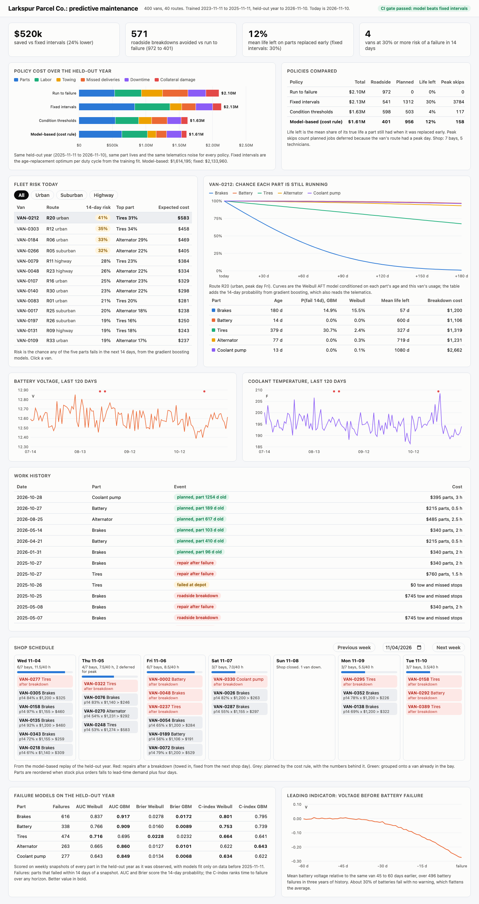
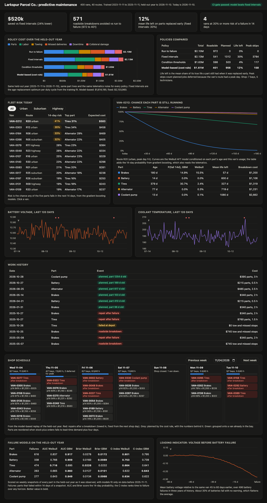

# Fleet predictive maintenance

Predictive maintenance for Larkspur Parcel Co., a made-up regional delivery company with 400 vans on 40 routes. It generates three years of daily telematics and repair history, fits a Weibull survival model and a gradient boosting classifier per component (brakes, battery, tires, alternator, coolant pump), and replays a held-out year under four maintenance policies with a real shop: limited bays and technicians, parts on the shelf with supplier lead times, and routes that should not lose a van on their peak day. A FastAPI service serves the fleet risk table, van detail, the daily shop plan, and the policy comparison, with a web UI.



**Held-out year** (2025-11-11 to 2026-11-10, 400 vans, 7 bays, 5 technicians). Every policy replays the same days: the same usage, the same part lives, and the same sensor noise.

| Policy | Total cost | Roadside breakdowns | Planned replacements | Life left on early replacements | Parts | Labor | Towing | Missed deliveries | Downtime | Collateral |
|---|---:|---:|---:|---:|---:|---:|---:|---:|---:|---:|
| Run to failure | $2,098,262 | 972 | 0 | 0% | $535,145 | $401,062 | $315,900 | $380,685 | $268,620 | $196,850 |
| Fixed intervals | $2,133,960 | 541 | 1,312 | 30% | $836,160 | $527,750 | $175,825 | $210,255 | $253,170 | $130,800 |
| Condition thresholds | $1,629,652 | 598 | 503 | 4% | $545,450 | $349,688 | $194,350 | $233,535 | $207,530 | $99,100 |
| **Model-based (cost rule)** | **$1,614,195** | **401** | 956 | 12% | $643,425 | $383,250 | $130,325 | $156,285 | $223,160 | $77,750 |

The model-based policy costs $520k (24%) less than fixed intervals and $484k less than running to failure, and it has 571 fewer roadside breakdowns than running to failure. Fixed intervals avoid 431 breakdowns but throw away 30% of the life of every part they pull, which costs more than the breakdowns they prevent. Condition thresholds come within $15k of the model on cost: they replace very little (503 parts, 4% of life wasted) because they only fire on strong signals, so they let 197 more vans break down on the road.

The fixed-interval row is the strongest fixed program I could build, not a strawman: per component and per duty cycle (urban, suburban, highway), the age-replacement optimum from the training-years Weibull fit, priced with the same costs the model policy uses. Brakes come out at 13,000 miles for urban vans and 59,000 for highway vans. A sensitivity run replacing every part at the age where 5%, 10%, or 20% of parts have failed costs $3.64M, $2.85M, and $2.51M.

**The cost tradeoff.** Replacing a part early wastes the life it has left. Waiting risks a breakdown, which costs a tow, the stops the van misses, a day or two of a spare van, emergency labor, and sometimes collateral damage (a dead coolant pump cooks the engine). The model policy replaces a part when

```
P(fail in next 14 days) x breakdown cost  >  planned job cost x (mean residual life / mean life) + visit cost
```

Worked example from the tests: brakes cost $590 planned ($340 parts, 2 hours at $125). With half its mean life left, replacing now throws away $295, plus $90 for half a day off the route: $385. A breakdown on an urban route adds $1,200. At a 30% failure probability waiting is cheaper ($360 < $385); at 35% it is not ($420 > $385). On a route's peak day the visit costs $400 instead of $90, so only stronger cases pull a van then. Once a van is in a bay the visit cost is sunk, so other parts ride along when their expected breakdown cost beats the wasted life alone.

## Why

A delivery fleet loses money twice on maintenance. A van that breaks down on its route needs a tow, misses half its stops, and sits out a day or more while dispatch finds a spare. A part replaced too early is money spent on life nobody used. Most fleets split the difference with mileage and calendar intervals, but one interval cannot fit an urban van that brakes 6 times per 100 miles and a highway van that brakes twice. Telematics already report the signals that come before many failures: battery voltage that sags for a month, coolant that runs hot, wear and pressure codes. This repo is a small working version of turning those signals into a daily shop plan and proving, on a year the models never saw, that it saves money against the alternatives.

## Architecture

```
 generator (seeded)                 engine (one day at a time)                    service
 ┌───────────────────────────┐    ┌─────────────────────────────────────────┐   ┌─────────────────────────────┐
 │ 400 vans, 40 routes,      │    │ parts age; telematics from true         │   │ FastAPI                     │
 │ urban / suburban / highway│──▶ │   remaining life (hidden from policies) │   │  /api/fleet   risk table    │
 │ daily miles, harsh brakes,│    │ failures: roadside or found at depot    │   │  /api/vans/id curves, history│
 │ idle, engine hours,       │    │ policy proposes ──▶ scheduler: bays,    │   │  /api/plan    shop schedule │
 │ ambient temperature,      │    │   technician hours, parts, peak days    │──▶│  /api/policies, /api/models │
 │ Weibull part lives scaled │    │ parts reorders with lead times          │   │  /healthz /metrics, JSON logs│
 │ by usage, per-install     │    │ cost ledger                             │   │  UI at /                    │
 │ random draws              │    └───────▲─────────────────────────────────┘   └─────────────────────────────┘
 └───────────────────────────┘            │
                     history (old practice, 3 years) ──▶ Weibull AFT + gradient boosting, trained on years 1-2
                     replays of year 3: run to failure, fixed intervals, condition thresholds, model-based
```

| Piece | File |
|---|---|
| Components, costs, shop, routes | `src/fleetmaint/config.py` |
| Synthetic fleet, part lives, telematics signal model | `src/fleetmaint/generator.py` |
| Daily simulation and cost ledger | `src/fleetmaint/engine.py` |
| Weibull AFT with censoring and left truncation, C-index, Kaplan-Meier | `src/fleetmaint/survival.py` |
| Leakage-safe features | `src/fleetmaint/features.py` |
| Training data, gradient boosting, evaluation, leading indicators | `src/fleetmaint/models.py` |
| Policies and the cost rule, age-replacement optimum | `src/fleetmaint/policies.py` |
| Shop plan and parts reorders | `src/fleetmaint/scheduler.py` |
| End to end build | `src/fleetmaint/pipeline.py` |
| API, metrics, logs, UI | `src/fleetmaint/app.py`, `prom.py`, `logs.py`, `static/index.html` |

How each piece works:

- **Synthetic data.** Half the vans run urban routes (75 miles a day, 6.5 harsh brakes per 100 miles, 34% idle), 30% suburban, 20% highway (185 miles, 1.8 harsh brakes, 14% idle). Vans run Monday to Saturday except four holidays. Each route has a peak weekday, and December 1 to 23 is peak season. Each component's life is Weibull with a shape from 1.7 (coolant pump, close to random) to 3.0 (brakes, clear wear-out) and a scale that shrinks with usage: harsh braking for brakes, miles for tires, idle time for batteries and alternators. An urban van's brakes last about 300 days, a highway van's about 500. Ground truth failure dates come from these draws.
- **Telematics.** Battery voltage sags by up to 0.4 V over the 45 days before a battery fails and drops with cold weather. A failing alternator pulls it down by 0.25 V over 21 days. Coolant runs up to 20 F hot over the 28 days before a pump fails, with random spikes from heavy loads. Each component has a fictional code (FM-B220 brake pad wear, FM-P310 low cranking voltage, FM-T405 tire pressure loss, FM-E140 charging circuit, FM-C510 coolant flow) that appears more often as failure nears, plus a 0.2% daily false alarm rate and three unrelated noise codes. Not every failure warns: 10% of brakes, 30% of batteries and alternators, 35% of coolant pumps, and 55% of tires (punctures) fail with no precursor.
- **History.** Three years under the company's old practice (brakes every 40,000 miles, tires every 50,000, everything else to failure): 3,227 failures and 3,933 repair orders. Parts in service on day one have install dates on file, so their lifetimes enter the survival fit with left truncation.
- **Survival model.** A Weibull accelerated failure time model per component on usage covariates (miles per day, harsh brakes per 100 miles, idle share, urban), fitted by maximum likelihood with scipy (I used scipy rather than lifelines to keep the image small and the likelihood visible). It handles censoring at the cutoff and at preventive replacements, and left truncation. On the training years it recovers the true shapes within 0.2 (brakes 2.96 vs 3.0, tires 2.11 vs 2.2) and the main usage effects (brakes: harsh braking -0.31 vs -0.30; tires: miles -0.27 vs -0.30).
- **Classifier.** Gradient boosting per component on 87,600 daily snapshots: part age, miles since install, the van's usage, the Weibull 14-day probability, 7-day voltage level and drop against the prior 3 weeks, coolant rise against the van's own baseline, the component's codes in the last 7 and 28 days (counting only since the current part went in), ambient temperature, and recent harsh braking. Label: the part fails within 14 days. Training snapshots stop 15 days before the cutoff so no label looks past it.
- **Policies.** Run to failure. Fixed intervals (above). Condition thresholds: a component's code twice in 7 days, 7-day mean voltage under 12.30 V, or coolant 12 F above the van's baseline. Model-based: the cost rule above, with gradient boosting probabilities and Weibull mean residual life.
- **Shop.** Each open day (Monday to Saturday) the scheduler fills 7 bays and 40 technician hours. Vans that broke down come first, oldest failure first, from the next shop day after the tow. Planned work follows by priority score, skipping vans on their route's peak day unless the case is strong enough to pay the peak visit cost. A van in a bay picks up its other due parts. Every job needs a part on the shelf.
- **Parts.** An (s, S) policy per component on stock plus open orders: reorder when the position falls to demand over the lead time plus 4 days, and order up to 14 more days of demand. Demand is the larger of the training-years rate and the last 28 days of use, so the fixed-interval program, which uses far more parts, gets reorders that keep up (it still waited on parts 1,408 times).

## Model scores on the held-out year

Weekly snapshots of every part in the held-out year as it was observed under the old practice. AUC and Brier score the 14-day probability. The C-index ranks time to failure over any horizon.

| Part | Failures in 14 days | AUC Weibull | AUC GBM | Brier Weibull | Brier GBM | C-index Weibull | C-index GBM |
|---|---:|---:|---:|---:|---:|---:|---:|
| Brakes | 616 | 0.837 | **0.917** | 0.0278 | **0.0172** | **0.801** | 0.795 |
| Battery | 338 | 0.766 | **0.909** | 0.0160 | **0.0089** | **0.753** | 0.739 |
| Tires | 474 | **0.716** | 0.695 | **0.0228** | 0.0232 | **0.664** | 0.641 |
| Alternator | 263 | 0.665 | **0.860** | 0.0127 | **0.0101** | 0.622 | **0.643** |
| Coolant pump | 277 | 0.643 | **0.849** | 0.0134 | **0.0068** | **0.634** | 0.622 |

Gradient boosting is much sharper about the next 14 days wherever a part warns, because it reads the telematics. The Weibull model ranks long-run time to failure about as well or better (C-index), because a 14-day classifier says little about whether a part has 60 or 300 days left. Tires, which mostly fail without warning, are where the classifier adds nothing. Both are well calibrated (expected calibration error under 0.01). Battery voltage falls 0.27 V on average over the 60 days before the 496 battery failures in history, starting about 30 days out.



## How to run

Requires [uv](https://docs.astral.sh/uv/). Docker is optional and not needed to run anything here.

```bash
make install           # uv sync --python 3.12
make train             # 400 vans, three years, every replay: about 20 seconds, writes data/bundle.pkl
make run               # API and UI on http://127.0.0.1:8884
```

Other commands:

```bash
uv run fleetmaint evaluate --gate                   # what CI runs; prints the table, exits 1 if the gate fails

curl "localhost:8884/api/fleet?limit=10&duty_cycle=urban"   # vans by 14-day risk, per-component probabilities
curl localhost:8884/api/vans/VAN-0212                       # telematics, survival curves, work history
curl "localhost:8884/api/plan?date=2026-03-02&days=7"       # shop plan, reorders, inventory by day
curl localhost:8884/api/policies                            # policy comparison, sensitivity runs, intervals
curl localhost:8884/api/models                              # Weibull fits, scores, leading indicators
curl localhost:8884/metrics
```

Other endpoints: `/api/summary`, `/healthz`. Logs are one JSON object per line with a request id, echoed in the `x-request-id` header. If `data/bundle.pkl` is missing, the service builds it on startup.

With Docker: `make docker-build && make docker-run`. The container builds the bundle on first start if its data directory is empty. The image is built and smoke tested in CI, not on this machine.

Screenshots: with the server running, `make screenshot` drives headless Chrome to write the images in `docs/`.

## Tests

```bash
uv run pytest -q       # 87 tests, about 15 seconds
uvx ruff check .
```

The suite builds one small fleet (120 vans, a 2-bay shop with one technician, so capacity binds) and checks:

- Generator (10): dates and shapes, same seed same fleet, no driving on Sundays and holidays, peak days follow each route's weekday, duty cycles differ, **usage shortens life** (top-quartile mileage vans have tires with 20%+ shorter lives, heavy brakers shorter brake lives), scale matches the spec, Weibull draws have the right median, voltage sags before battery failure only when the part warns, code rates rise near failure and noise is shared across policies.
- Survival (10): **Weibull fit recovers shape, intercept, and coefficients on a clean sample**, with right censoring, and with left truncation (where a naive fit is biased), the gradient against finite differences, **C-index on a hand-worked example** (4 of 5 comparable pairs concordant), ties and extremes, conditional failure probability, mean residual life against numerical integration, quantiles, Kaplan-Meier by hand.
- Models (10): survival data respects the cutoff, **the time split has no leakage** (scrambling every signal and every part's fate after the cutoff leaves training features and labels unchanged), spell lookup, censored windows dropped, usage effects have the right sign, both models beat chance and gradient boosting wins on brakes, voltage falls before battery failure, reliability and calibration error, features, observed usage tracks the truth.
- Policies (10): breakdown cost by hand, **the cost rule on a worked example**, early cost capped at a full part, an age-replacement optimum exists for wear-out parts and not for random failures, run to failure, fixed intervals by days and by miles with ride-along, condition rules need two codes since the current install, voltage and coolant thresholds.
- Scheduler (9): **bays and technician hours respected**, breakdowns first and oldest first, no repair on the failure day, peak days skipped unless urgent, grouping on one bay, grouping onto a breakdown, no part no job, **reorder point and quantity by hand**, demand from trailing use.
- Simulation (24): for each of the four policies, **cost categories add up and parts, labor, towing, missed deliveries, and collateral match the ledger by hand**, **capacity is respected every day**, and **inventory balances** (start plus received minus used equals end, never negative); run to failure wastes nothing, wasted life equals true life minus age, emergency repairs follow the failure, every replay starts from the same fleet, determinism, policies avoid breakdowns, peak days are protected, reorders arrive after the lead time.
- API (14): health, metrics, UI, summary, fleet sorted by risk, duty cycle filter, van detail with survival curves that start at 1 and only go down, 404s and 400s, a day's plan within capacity, Sundays closed, a week of plans, policies, models, request id and JSON logs, the CI markdown table.

CI (`.github/workflows/ci.yml`) runs lint and tests, a **policy gate** job that builds the full 400-van run and fails unless the model-based policy's total cost beats fixed intervals on the held-out year (it writes the table to `$GITHUB_STEP_SUMMARY` and uploads the JSON), and a Docker job that builds the image and smoke tests the API.

Honest notes on choices: the cost constants (tow $325, $220 a day for a spare van, half a route's stops missed) and the warning rates were set by me, not fitted to anything real, and they decide how much preventive work pays. While building it I fixed two things that changed the results: codes from a replaced part were counting against the new one (which made the condition policy replace parts twice), and I changed fixed intervals from one fleet-wide quantile to the per-duty-cycle age-replacement optimum, which made that baseline stronger. I also tried a variant of the cost rule that discounts the wasted life by the failure probability; it cost $25k more, so I kept the simpler rule. Seed 7 is the only seed reported.

## Production notes

- Part lives would come from the repair order system, with install dates, part numbers, and vendors, and the survival fits would add vendor and model year. The covariates would be time-varying (a van moved from highway to urban mid-life), which needs a counting-process likelihood instead of van-level averages.
- Telematics would arrive as a stream from the vehicle gateways into a feature store with daily snapshots, so the features used to train match the ones served. Sensor dropouts and gateway clock drift are the first things to handle.
- The decision rule would be checked against technician findings: a planned replacement whose old part tested fine is a false alarm, which gives a label stream the simulation gets for free.
- The scheduler would become a small optimization (bays, technician skills, part kits, van rotation across depots) and publish to the shop's work order system, with a human approving the plan each evening.
- Parts would be ordered against the model's own demand forecast (the sum of failure probabilities over the lead time) rather than trailing use, shared across depots.
- Retraining would run monthly, and a model would be promoted only after it passes the same replay gate on the latest held-out months.

## License

MIT. See [LICENSE](LICENSE).
